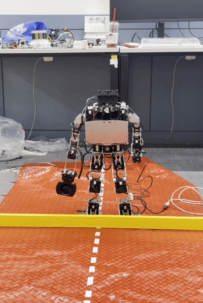

# Humanoid-Motion-Teacher

## build essential

```
sudo apt-get install libqwt-qt5-dev
sudo apt-get install ros-humble-dynamixel-sdk
```

## how to build

```
cd ../Humanoid-Motion-Teacher
mkdir build
cd build
cmake ..
make
./Humanoid-Motion-Teacher
```

## how to use

pdf는 motion-teacher와 motion-operator 사용 tip이다.

ppt는 ui 관련 사용법이다.


[Motion-TeacherMotion-Operator.pdf](https://github.com/user-attachments/files/23744035/Motion-TeacherMotion-Operator.pdf)

[Robit_Humanoid_Motion_Teacher_v2.pptx](https://github.com/user-attachments/files/18498512/Robit_Humanoid_Motion_Teacher_v2.pptx)



